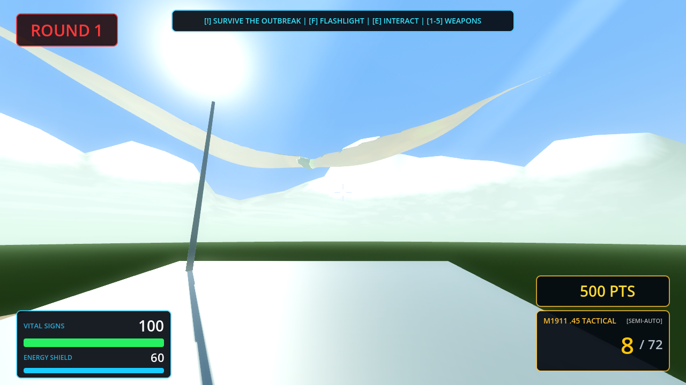
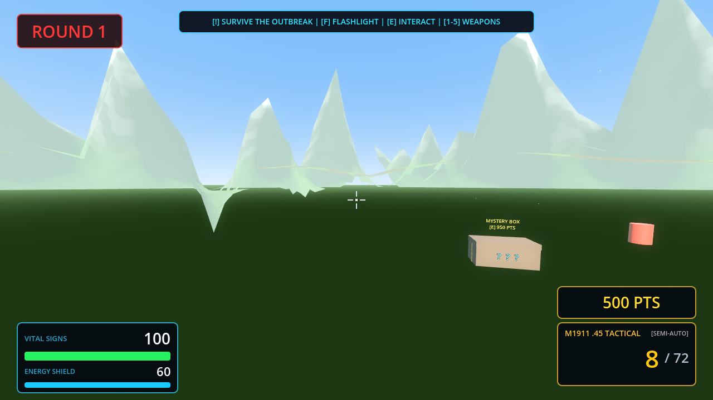
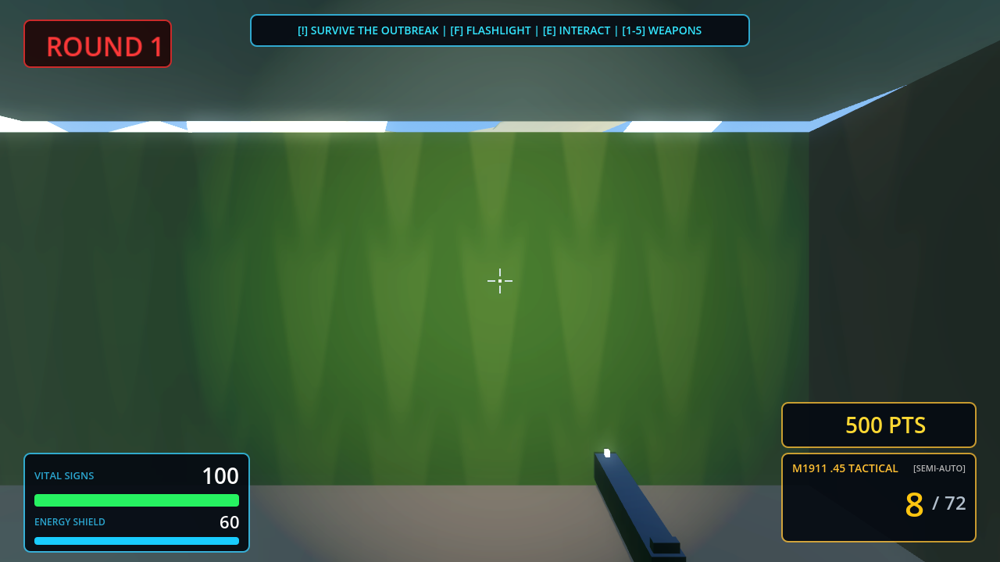
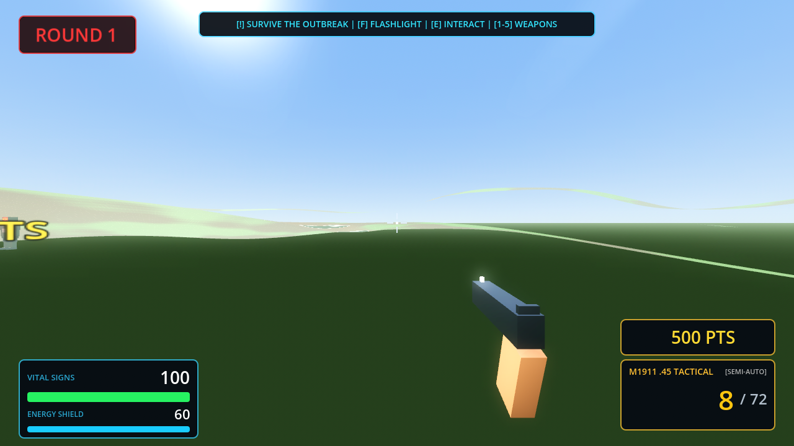

# 🌲 BLACKWOOD PINES: DEADWOOD OUTBREAK

[](https://godotengine.org)
[](https://mesa3d.org)
[](https://ubuntu.com)
[]()
[]()
[](LICENSE)

A photorealistic, adrenaline-fueled survival horror First-Person Shooter engineered in **Godot 4.3**. Stranded in the isolated Blackwood Alpine Valley, you must survive relentless undead horde incursions, master authentic firearms, repair fortified barricades, unlock mystery crates, and drink vital combat perks before the valley consumes you.

---

## 📸 In-Game Visuals & Environment

| Alpine Mountain Vista (360° Panorama) | Dense Old-Growth Forest Understory |
| :---: | :---: |
|  |  |

| Tactical Weapon Ready on Trail | First-Person Combat Iron Sights |
| :---: | :---: |
|  |  |

---

## 🕹️ Controls & Tactical Input

| Action | Control | Tactical Effect |
| :--- | :---: | :--- |
| **Locomotion** | <kbd>W</kbd> <kbd>A</kbd> <kbd>S</kbd> <kbd>D</kbd> | Smooth kinematic traversal across rolling alpine hills |
| **Sprint** | <kbd>Shift</kbd> | High-speed dash ($10.5\text{ m/s}$) with FOV dynamic expansion |
| **Jump** | <kbd>Space</kbd> | Jump with coyote-time buffer & slope velocity preservation |
| **Crouch / Slide** | <kbd>Ctrl</kbd> / <kbd>C</kbd> | Tactical slide downhill when engaged during full sprint |
| **Fire Primary** | <kbd>LMB</kbd> | Discharge chambered firearm with 2nd-order spring recoil |
| **Aim Down Sights** | <kbd>RMB</kbd> | Tighten spread, zoom FOV to $54^\circ$, align iron sights |
| **Manual Reload** | <kbd>R</kbd> | Tactical magazine / tube reload |
| **Quick-Switch** | <kbd>Q</kbd> | Instantly swap between active and previously held weapon |
| **Cycle Arsenal** | <kbd>Scroll Up</kbd> / <kbd>Down</kbd> | Sequentially rotate through equipped firearms |
| **Slot Hotkeys** | <kbd>1</kbd> - <kbd>5</kbd> | Direct instantaneous weapon selection |
| **Interact / Repair** | <kbd>E</kbd> | Repair barricade planks, purchase wall-buys, buy perks |
| **Pause / Release Mouse** | <kbd>Esc</kbd> | Free mouse cursor & access system menu |

---

## 🔫 Authentic 5-Weapon Arsenal

Every firearm features custom 3D procedural modeling, damped harmonic recoil springs, dynamic reticle bloom, muzzle flash lighting, and caliber-accurate ballistics:

| Slot | Firearm | Caliber | Mag Capacity | Fire Rate | Tactical Role |
| :---: | :--- | :--- | :---: | :---: | :--- |
| **1** | **M1911 Tactical** | .45 ACP | 7 / 70 | Semi-Auto ($420\text{ RPM}$) | Pinpoint close-quarters sidearm |
| **2** | **Remington 870 Police** | 12-Gauge | 8 / 72 | Pump-Action ($68\text{ RPM}$) | Devastating 8-pellet buckshot blast |
| **3** | **AK-47 Kalashnikov** | 7.62x39mm | 30 / 180 | Full-Auto ($600\text{ RPM}$) | Heavy armor-penetrating automatic rifle |
| **4** | **M4A1 SOPMOD** | 5.56x45mm | 30 / 210 | Full-Auto ($800\text{ RPM}$) | Low-recoil precision tactical carbine |
| **5** | **Colt Python** | .357 Magnum | 6 / 36 | Revolver ($180\text{ RPM}$) | Massive kinetic stopping power |

---

## 🌲 Environment & Rendering Architecture

* **360° Alpine Mountain Chain:** Four colossal jagged mountain ridges ($65\text{m} - 85\text{m}$) frame the valley play zone.
* **Elevation-Based Shading (`alpine_mountain.gdshader`):**
  * $y < 22\text{m}$: Dark mossy conifer foothills.
  * $y \in [22, 55]\text{m}$: Sheer granite cliffs with horizontal geological fissures.
  * $y > 55\text{m}$: Glaciated alpine snow caps with sun glint and specular reflections.
* **15,350+ Instanced Foliage Assets (8 GPU MultiMeshes):**
  * 1,800 Douglas Pines ($18\text{m}-28\text{m}$) with 4-tier needle branches
  * 1,000 Broadleaf Hardwood Oaks ($12\text{m}-18\text{m}$)
  * 700 Silver Mountain Birches ($10\text{m}-16\text{m}$) with white bark
  * 1,800 Understory Shrubs & Berry Bushes ($1.8\text{m}-3.2\text{m}$)
  * 3,500 Lush Feathered Ferns ($0.7\text{m}-1.3\text{m}$)
  * 5,500 Wild Grass & Alpine Wildflower Tufts ($0.4\text{m}-0.8\text{m}$)
  * 450 Mossy Nurse Logs ($6\text{m}-10\text{m}$)
  * 600 Glacial Granite Boulders ($1.8\text{m}-4.5\text{m}$)
* **HeightMapShape3D Kinematic Collision:** Native 121×121 continuous heightfield collision eliminating ghost edges and ensuring flawless CharacterBody3D slope navigation.

---

## 🧟 Core Survival Mechanics

* **Round-Based Escalation:** `BlackwoodHordeDirector` handles wave progression, zombie sprint speeds, spawn quotas, and audio stinger crescendos.
* **Dynamic Dismemberment & Decapitation:** Headshots decapitate undead targets, triggering high-pressure arterial blood fountains and limb gib physics.
* **Barricade Fortification:** Board up broken windows with wooden planks (<kbd>E</kbd>) to delay incoming zombies and earn bonus points (+10 PTS/plank).
* **Wall-Buy Stations:** Interactive chalk wall outlines allow purchasing firearms or topping up reserve ammunition.
* **Perk Vending Machines:** Quench your thirst with **Juggernog** to permanently boost maximum health from 100 to 250 HP.
* **Mystery Box Roulette:** Spend 950 PTS to cycle the random 3D weapon roulette under a beacon of light.

---

## 🚀 Quick Start & Launch Instructions

### Prerequisites
* Linux (Ubuntu 24.04 LTS or compatible distribution)
* Godot Engine 4.3 Stable
* GPU with OpenGL 3.3+ / 4.6 (Compatible with Intel UHD, AMD Radeon Vega / RDNA, NVIDIA GeForce)

### Launching the Game
```bash
# Clone the repository
git clone https://github.com/kaizxark/blackwood-pines.git
cd blackwood-pines

# Launch the game directly
./run_game.sh
```

### Opening the Project in Godot Editor
```bash
./run_editor.sh
```

### Running the Automated Test Suites
```bash
# Verify all 7 core survival systems (locomotion, weapons, barricades, perks, etc.)
./bin/godot --headless --script tests/test_zombie_survival_loop.gd

# Verify mountain vistas, multi-mesh asset counts, and weapon cycling
./tests/verify_epic_overhaul.gd
```

---

## 📁 Project Architecture

```
blackwood-pines/
├── assets/
│   ├── materials/        # PBR material overrides
│   └── shaders/          # Custom GLSL shaders (mountain, terrain, foliage, rock)
├── core/
│   ├── BlackwoodHordeDirector.gd  # Round manager & zombie spawner
│   ├── BloodManager.gd            # Decals, gibs, and arterial blood fountains
│   ├── EventBus.gd                # Global decoupled signal hub
│   ├── GameManager.gd            # Score, perks, health, and global state
│   └── SoundManager.gd           # Procedural audio synth & sound pool
├── entities/
│   ├── player/           # First-person controller, camera pivot, and movement
│   └── enemies/zombie/   # Undead NPC, decapitation, and navmesh pathfinding
├── interactables/        # Barricades, wall-buys, perk machines, mystery box
├── levels/
│   └── zombie_outbreak/  # Blackwood_Pines.tscn alpine forest arena
├── tests/                # Automated verification suites & scene generators
├── ui/                   # Retro tactical HUD, health bars, crosshair, and killfeed
└── weapons/              # 5-weapon arsenal definitions, ballistics, and WeaponManager
```

---

## 📜 License
Developed for Project Proto-Breach under the MIT License.

<!-- Initial documentation milestone: Complete controls, lore, weapon stats, and rendering architecture -->

---

## 📊 System Requirements & Hardware Benchmarks

| Component | Minimum Specification | Recommended Specification |
| :--- | :--- | :--- |
| **OS** | Linux (Ubuntu 22.04+, Debian, Arch, Fedora) | Ubuntu 24.04 LTS (x86_64) |
| **Processor** | Dual-Core Intel Core i3 / AMD Ryzen 3 | Quad-Core AMD Ryzen 5 / Intel Core i5 |
| **Memory** | 4 GB RAM | 8+ GB RAM |
| **Graphics** | Integrated AMD Radeon Vega 8 / Intel UHD 630 | Dedicated GPU (NVIDIA GTX 1060 / AMD RX 580+) |
| **OpenGL** | OpenGL 3.3 Core Profile | OpenGL 4.6 (Core Profile) Mesa 25+ |
| **Target FPS** | 60 FPS (Compatibility Mode) | 120+ FPS (High-Fidelity) |

---

## ❓ Frequently Asked Questions (FAQ)

**Q: How do I switch weapons in the heat of combat?**  
A: You can use your mouse scroll wheel, press number keys <kbd>1</kbd> through <kbd>5</kbd>, or hit <kbd>Q</kbd> to quick-switch between your active and previously held weapon.

**Q: Where can I find more ammunition?**  
A: Wall-Buy chalk stations scattered around the perimeter allow you to purchase fresh reserve ammo for $250\text{ PTS}$ at any time.

**Q: How does zombie decapitation work?**  
A: Accurate headshots trigger instant decapitation, spawning high-velocity arterial blood fountains and granting maximum score points (+100 PTS).
